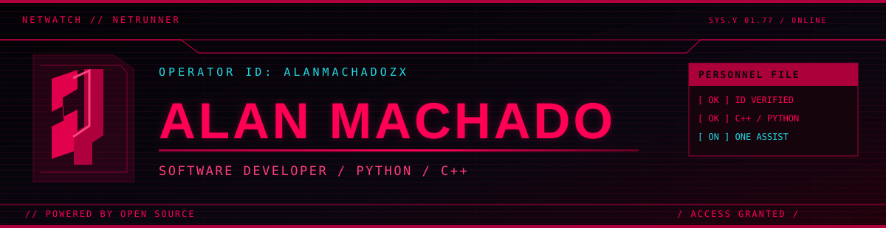

  

  
  
  

### `01 // ABOUT`

Computer Science student and software developer working with **Python**, **C++**, and **Linux**. I enjoy building practical software, understanding how systems work, and improving the way code is organized and maintained.

Currently contributing to the **[One organization](https://github.com/one-assist)**.

---

### `02 // TECHNOLOGY INVENTORY`

**Languages & data**

**Libraries**

**Tools**

---

### `03 // PROJECTS`

| Repository | Description |
|:--|:--|
| **[One](https://github.com/one-assist/One)** | Python desktop assistant for voice-driven commands and system actions. |
| **[One-classifier](https://github.com/one-assist/One-classifier)** | Experimental C++ project exploring text tokenization and vectorization. |

  

  <code>// END OF TRANSMISSION // ALANMACHADOZX //</code>

